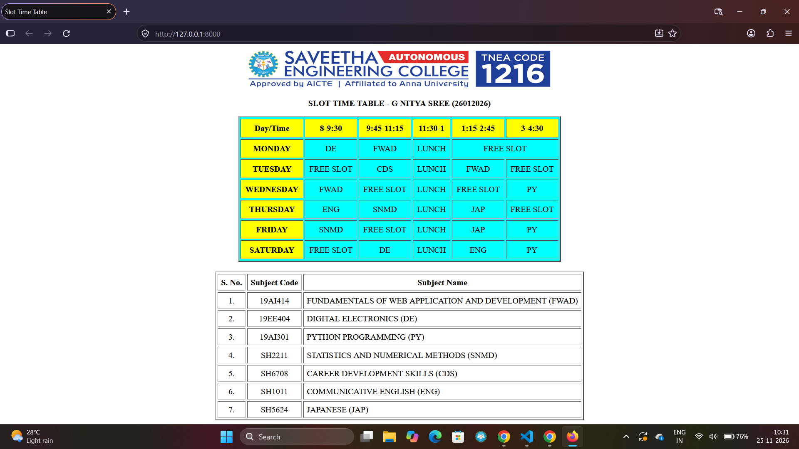
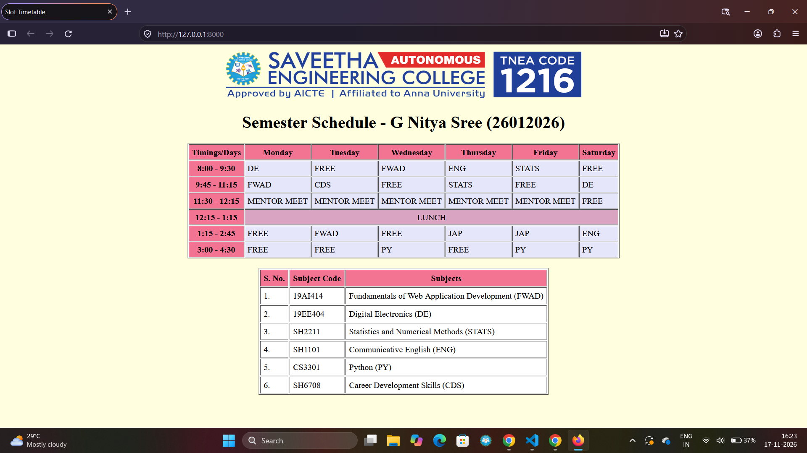

# Ex02 Time Table
## Date: 17.11.2026

## AIM
To write a html webpage page to display your slot timetable.

## ALGORITHM
### STEP 1
Create a Django-admin Interface.

### STEP 2
Create an App inside the Django project.

### STEP 2
Create a static folder uder the created App and insert HTML code.

### STEP 3
Create a simple table using ```<table>``` tag in html with the relevant attributes.

### STEP 4
Add rows using ```<tr>``` tag.

### STEP 5
Add your course schedule using ```<td>``` tag.

### STEP 6
Execute the program using runserver command.

## PROGRAM
```
slot.html


<html>
<head>
    <title>Slot Timetable</title>
</head>
<center>

</center>
<body bgcolor="lightyellow">

    <h1 align="center">Semester Schedule - G Nitya Sree (26012026)</h1>

    <table border="1" bgcolor="white" align="center"
           cellpadding="5" cellspacing="1">

        <tr style="background-color: rgb(243, 115, 147)">
            <th>Timings/Days</th>
            <th>Monday</th>
            <th>Tuesday</th>
            <th>Wednesday</th>
            <th>Thursday</th>
            <th>Friday</th>
            <th>Saturday</th>
        </tr>

        <tr style="background-color:lavender">
            <th style="background-color: rgb(243, 115, 147);">8:00 - 9:30</th>
            <td>DE</td>
            <td>FREE</td>
            <td>FWAD</td>
            <td>ENG</td>
            <td>STATS</td>
            <td>FREE</td>
        </tr>

        <tr  style="background-color:lavender">
            <th style="background-color: rgb(243, 115, 147);">9:45 - 11:15</th>
            <td>FWAD</td>
            <td>CDS</td>
            <td>FREE</td>
            <td>STATS</td>
            <td>FREE</td>
            <td>DE</td>
        </tr>

        <tr  style="background-color:lavender">
            <th style="background-color: rgb(243, 115, 147);">11:30 - 12:15</th>
            <td>MENTOR MEET</td>
            <td>MENTOR MEET</td>
            <td>MENTOR MEET</td>
            <td>MENTOR MEET</td>
            <td>MENTOR MEET</td>
            <td>FREE</td>
        </tr>

        <tr  style="background-color:rgb(217, 163, 194)">
            <th style="background-color: rgb(243, 115, 147);">12:15 - 1:15</th>
            <td colspan="6" align="center">LUNCH</td>
        </tr>

        <tr  style="background-color:lavender">
            <th style="background-color: rgb(243, 115, 147);">1:15 - 2:45</th>
            <td>FREE</td>
            <td>FWAD</td>
            <td>FREE</td>
            <td>JAP</td>
            <td>JAP</td>
            <td>ENG</td>
        </tr>

        <tr  style="background-color:lavender">
            <th style="background-color: rgb(243, 115, 147);">3:00 - 4:30</th>
            <td>FREE</td>
            <td>FREE</td>
            <td>PY</td>
            <td>FREE</td>
            <td>PY</td>
            <td>PY</td>
        </tr>

    </table><br>
    
    <table border="1" bgcolor = "white" align="center"
    cellpadding="6" cellspacing="2">
    
        <tr style="background-color: rgb(243, 115, 147);">
            <th>S. No.</th>
            <th>Subject Code</th>
            <th>Subjects</th>
        </tr>

        <tr>
            <td>1.</td>
            <td>19AI414</td>
            <td>Fundamentals of Web Application Development (FWAD)</td>
        </tr>

        <tr>
            <td>2.</td>
            <td>19EE404</td>
            <td>Digital Electronics (DE)</td>
        </tr>

        <tr>
            <td>3.</td>
            <td>SH2211</td>
            <td>Statistics and Numerical Methods (STATS)</td>
        </tr>

        <tr>
            <td>4.</td>
            <td>SH1101</td>
            <td>Communicative English (ENG)</td>
        </tr>

        <tr>
            <td>5.</td>
            <td>CS3301</td>
            <td>Python (PY)</td>
        </tr>

        <tr>
            <td>6.</td>
            <td>SH6708</td>
            <td>Career Development Skills (CDS)</td>
        </tr>

    </table>
</body>
</html>

views.py

from django.shortcuts import render
def slot(request):
    return render(request,'scheduleapp/slot.html')

urls.py

from django.urls import path
from . import views

urlpatterns = [path('', views.slot, name='slot'),]
```
## OUTPUT





## RESULT
The program for creating slot timetable using basic HTML tags is executed successfully.
